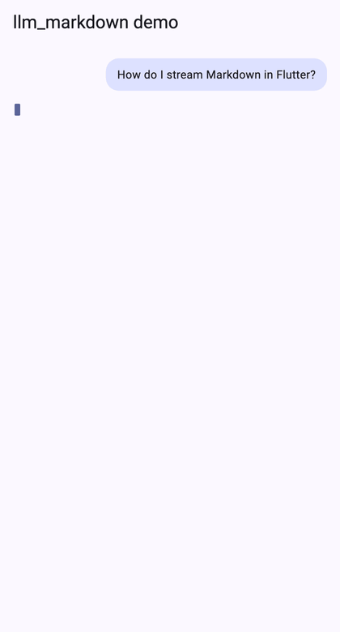

# llm_markdown

[](https://pub.dev/packages/llm_markdown)
[](https://pub.dev/packages/llm_markdown/score)
[](https://pub.dev/packages/llm_markdown/score)
[](https://github.com/anant8140/llm_markdown/actions/workflows/ci.yml)
[](LICENSE)

Markdown widget for chat apps that stream replies from an LLM.



If you render a streaming reply with a regular Markdown widget, the whole
text is parsed again on every chunk. That gets slow on long answers, you see
raw `**` and backticks until the closing ones arrive, and code blocks flicker
when they get highlighted.

This package fixes that:

- Only the last unfinished block is parsed again. Finished blocks are built
  once and cached.
- Unfinished syntax is closed before rendering, so `**bold`, an open code
  fence or a half-typed `[link](https://...` already looks right. Tables show
  up once the header row is done.
- Text is revealed at a steady speed instead of in bursts, and it speeds up
  if it falls behind.
- Code blocks have a copy button and get syntax highlighting once closed.
- LaTeX math: `$...$`, `\(...\)`, `$$...$$` and `\[...\]`. Prices like
  "$5 and $10" are left alone.
- Reasoning from `<think>...</think>` (DeepSeek, Qwen, ...) or from a separate
  reasoning stream goes into a collapsible "Thought for 12s" section.
- The newest characters fade in as they appear.
- Screen readers don't read half sentences; the reply is announced once
  it's done. Arabic, Hebrew and other right-to-left text gets the right
  direction per paragraph, even in a left-to-right app.
- Optional auto-scroll that stops when the user scrolls up to read.
- Depends only on `flutter/widgets.dart`, so it works with `material_ui`, the
  old `flutter/material.dart`, Cupertino or no design library at all.

It doesn't talk to any model API. You give it text, it renders it.

## Install

```sh
flutter pub add llm_markdown
```

## Usage

With a controller:

```dart
final controller = StreamingMarkdownController();

// build()
StreamingMarkdown(controller: controller)

// when the reply comes in
await for (final chunk in model.generate(prompt)) {
  controller.append(chunk);
}
controller.complete();
```

`controller.addStream(stream)` does the loop for you. `controller.text` has
the full markdown, e.g. for a "copy reply" button.

Straight from a stream:

```dart
StreamingMarkdown.stream(replyStream)
```

A stream can only be listened to once, so inside a `ListView` (items get
disposed when they scroll away) keep a controller per message instead.

Or from text you already keep in your state:

```dart
StreamingMarkdown.text(message.text, isComplete: message.done)
```

If the new text starts with the old one, only the added part is processed.

### Math

Formulas are found and kept intact while they stream; drawing them is up to
you, so you can pick the math package. With
[`flutter_math_fork`](https://pub.dev/packages/flutter_math_fork):

```dart
StreamingMarkdown(
  controller: controller,
  mathBuilder: (context, tex, display) => Math.tex(
    tex,
    mathStyle: display ? MathStyle.display : MathStyle.text,
  ),
)
```

A formula that is still arriving shows its source until it's closed. Without
a `mathBuilder` the source is shown.

### Thinking

If the reply starts with `<think>...</think>`, that part goes into a section
above the answer. It shows "Thinking..." while it streams and "Thought for
Ns" after. For APIs that send reasoning separately:

```dart
controller.appendThinking(reasoningChunk);
controller.append(answerChunk);
```

`showThinking: false` drops it, `thinkingInitiallyExpanded: true` opens it,
and `thinkingLabel` changes the title (e.g. to translate it).

### Chat list

```dart
SelectionArea(
  child: ListView(
    controller: scrollController,
    children: [
      for (final message in messages)
        StreamingMarkdown(
          controller: message.controller,
          autoScrollController: scrollController,
        ),
    ],
  ),
)
```

`SelectionArea` comes from your design library and makes the text
selectable. With `ListView(reverse: true)` you don't need
`autoScrollController`.

## Options

| Option | Default | |
| --- | --- | --- |
| `smoothing` | `Smoothing.adaptive()` | `Smoothing.none()` shows text right away; `fadeLength: 0` turns the fade off |
| `mathBuilder` | – | draws LaTeX, see above |
| `showThinking` | `true` | |
| `thinkingInitiallyExpanded` | `false` | |
| `thinkingLabel` | English | title of the thinking section |
| `style` | from context | see below |
| `onLinkTap` | – | called with the link URL |
| `imageBuilder` | `Image.network` | |
| `codeBlockBuilder` | built-in | return `null` to fall back to the default |
| `highlightCode` | `true` | |
| `showCursor` | `true` | blinking cursor while streaming |
| `newlinesAsBreaks` | `false` | treat a single newline as a line break |
| `autoScrollController` | – | follow the reply while at the bottom |
| `announceWhenDone` | `true` | screen readers read the reply when it ends |
| `detectTextDirection` | `true` | per-paragraph direction from the first letter |

### Styling

The default style takes the text style from `DefaultTextStyle` and the accent
(links, checkboxes, cursor) from `DefaultSelectionStyle`. Material and
Cupertino apps set both from their theme. To set it yourself:

```dart
StreamingMarkdown(
  controller: controller,
  style: StreamingMarkdownStyle.fromColors(
    textStyle: theme.textTheme.bodyMedium!,
    accentColor: theme.colorScheme.primary,
  ).copyWith(blockSpacing: 16),
)
```

`healIncompleteMarkdown()` is exported too, in case you want the healing
with a different renderer.

## Performance

A 12,800-character reply streamed in 12-character chunks every 16 ms, on a
Mac Studio in profile mode:

| | build avg | build p90 | worst frame |
| --- | --- | --- | --- |
| llm_markdown | 0.65 ms | 1.56 ms | 16.0 ms |
| `MarkdownBody` with the whole text per chunk | 6.01 ms | 12.53 ms | 16.1 ms |

Phones are slower, so expect both columns to be several times higher there.
To run it yourself: `flutter run --profile -t lib/benchmark.dart` in
`example/`.

## How it works

The text is split into blocks only at points where nothing that comes later
can change the block before it (a blank line before a new paragraph, the end
of a heading, a closing code fence, ...). Those blocks are parsed once with
[`markdown`](https://pub.dev/packages/markdown). The last block is healed and
parsed again whenever new text arrives, at most once per frame.

The tests stream sample replies one character at a time, line by line and in
random chunks, plus a few thousand generated documents, and check that every
finished block matches a normal parse of the full text.

## Limitations

- Once a footnote definition appears, the reply is parsed as a whole again
  (correct, just not incremental).
- Raw HTML is shown as text.
- Inline math has to fit on one line.

Tested on Flutter 3.35 and 3.50.

## License

MIT
