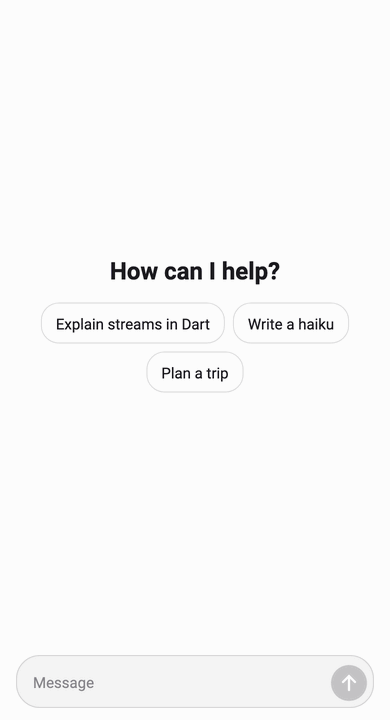

# llm_markdown_chat

A ready AI chat screen for Flutter, on top of
[llm_markdown](https://pub.dev/packages/llm_markdown): replies stream in as
Markdown without flicker, with code, tables, math and diagrams.

- Message list that keeps the newest reply in view while it grows
- Input box that grows with the text; Enter sends, Shift+Enter adds a line
- Send button that turns into stop while a reply is written
- Copy, "Try again" and thumbs up/down under the replies
- Edit a sent message and ask again from there
- A welcome widget and suggestions while the chat is empty
- Save and restore a chat as JSON
- Attachments and voice input through callbacks, with the plugins you choose
- Several chats with a list to switch between them
- A ready connection to a streaming (server-sent events) endpoint
- Errors shown in the reply, with the text so far kept
- Plain widgets: fits Material, Cupertino or your own design, follows the
  app's text style and accent color
- Works with any model: you write the reply into a controller, for example
  with the OpenAI, Anthropic, Gemini, Ollama or Firebase AI adapters of
  `llm_markdown`

**[Try it in the browser](https://anant8140.github.io/llm_markdown/chat/)**
(a pretend model, no key needed)



## Usage

```dart
import 'package:llm_markdown/llm_markdown.dart';
import 'package:llm_markdown_chat/llm_markdown_chat.dart';

final chat = LlmChatController(
  onReply: (prompt, reply, history) async {
    final request = http.Request('POST', Uri.parse(url))
      ..headers.addAll(headers)
      ..body = jsonEncode({
        'model': 'gpt-4.1-mini',
        'stream': true,
        'messages': [
          for (final message in history)
            {'role': message.role.name, 'content': message.text},
          {'role': 'user', 'content': prompt},
        ],
      });
    final response = await client.send(request);
    await reply.addOpenAIStream(response.stream);
  },
);

// in the widget tree:
LlmChatView(
  controller: chat,
  suggestions: const ['What can you do?'],
)
```

`onReply` gets the prompt, the reply's `StreamingMarkdownController` and
the chat before the prompt. Any stream of text works too:
`await reply.addStream(myStream)`. When `onReply` ends the reply is
completed; an error ends it with that error.

The stop button calls `chat.stop()`, which completes the reply; the
adapters and `addStream` then cancel the response, which closes the
request.

## Connecting a streaming endpoint

`LlmChatController.sse` asks an endpoint that answers with server-sent
events, through
[server_sent_events](https://pub.dev/packages/server_sent_events):

```dart
final chat = LlmChatController.sse(
  url: Uri.parse('https://api.openai.com/v1/chat/completions'),
  headers: {'Authorization': 'Bearer $apiKey'},
  body: SseChatBackend.openAIBody(model: 'gpt-4.1-mini'),
);
```

`body` makes the request body from the messages (the chat so far and the
new prompt, with its attachments). `text` takes the reply's text out of the
events; it defaults to OpenAI Chat Completions and Responses:

```dart
LlmChatController.sse(
  url: Uri.parse('https://api.anthropic.com/v1/messages'),
  headers: {'x-api-key': apiKey, 'anthropic-version': '2023-06-01'},
  body: (messages) => {
    'model': 'claude-sonnet-4-5',
    'max_tokens': 1024,
    'stream': true,
    'messages': [
      for (final message in messages)
        {'role': message.role.name, 'content': message.text},
    ],
  },
  text: (events) => events.anthropicText(),
)
```

When the API answers with an error, the reply ends with the
`SseException` and the view shows the message of its body, such as
`Invalid API key` (`chatErrorText(error)` gives that text). The stop button
aborts the request. `SseChatBackend` is the same as a class, to use as
`onReply: backend.call`; in tests pass `client: FakeSseClient(...)` from
`package:server_sent_events/testing.dart`.

## Message actions

A finished reply has a copy button, the last one also "Try again"
(`chat.regenerate(message)`, which drops the reply and asks again with the
same user message). With `onFeedback` there are thumbs up and down too:

```dart
LlmChatView(
  controller: chat,
  onFeedback: (message, isPositive) => report(message.id, isPositive),
  showCopy: true,          // each can be turned off
  showRegenerate: true,
  copyPlainText: false,    // true copies without the Markdown marks
  // or build your own row:
  messageActionsBuilder: (context, message) => MyActions(message),
)
```

## Editing a message

Each message of the user has an "Edit" button (`showEdit: false` hides it).
It puts the text back in the input box; sending then replaces that message
and everything after it, and asks again. From code:

```dart
await chat.edit(chat.messages[2], 'A better question');
```

## Saving and restoring a chat

```dart
final saved = jsonEncode(chat.toJson());
// later
final chat = LlmChatController.fromJson(
  jsonDecode(saved) as Map<String, Object?>,
  onReply: askModel,
);
```

The JSON has a `version` and the messages with their `id`, `role`, `text`
and `time`, the attachments of user messages, and the `thinking`, `sources`
and `error` of replies; `toJson(thinking: false, sources: false,
attachmentBytes: false)` leaves parts out. Tool calls are not saved.
Restored replies are complete: they are shown at once, without a cursor.

Messages can also be given directly:

```dart
LlmChatController(
  onReply: askModel,
  history: [
    ChatMessage.user('Hi'),
    ChatMessage.assistant('Hello! How can I help?'),
  ],
)
```

## Welcome and suggestions

```dart
LlmChatView(
  controller: chat,
  welcome: const Text('How can I help?'),
  suggestions: const ['Explain streams in Dart', 'Plan a trip'],
)
```

Both are shown while the chat is empty; a tap on a suggestion sends it.

## Attachments and voice input

The package has no plugins of its own. Give it callbacks and use the
picker and speech plugins you like:

```dart
LlmChatView(
  controller: chat,
  // shows an attach button; the picked files are listed above the input
  // and can be removed there
  onPickAttachment: () async {
    final file = await openFile(); // for example with file_selector
    if (file == null) return [];
    return [
      ChatAttachment(
        name: file.name,
        mimeType: file.mimeType,
        bytes: await file.readAsBytes(), // or uri: file.path
      ),
    ];
  },
  // how an attachment looks, above the input and in the message
  attachmentBuilder: (context, attachment) => Text(attachment.name),
  // shows a microphone button; the text goes into the input box
  onVoiceInput: () => listenOnce(), // returns the words, or null
)
```

The sent message carries them in `message.attachments`. In `onReply`,
`chat.lastUserMessage` is the prompt being answered; the `body` of
`LlmChatController.sse` gets it as the last message.

## Several chats

`ChatListController` keeps a list of chats, each with its own
`LlmChatController`, and `ChatListView` shows it:

```dart
final chats = ChatListController(onReply: askModel)..create();

// in a drawer or side panel
ChatListView(controller: chats, onSelected: (_) => Navigator.pop(context))

// the screen
ListenableBuilder(
  listenable: chats,
  builder: (context, _) =>
      LlmChatView(controller: chats.selected!.controller),
)
```

`create()`, `select(chat)`, `rename(chat, 'Trip')` and `delete(chat)`
change the list. A chat's title is the start of its first user message
until it is renamed. `chats.toJson()` and `ChatListController.fromJson`
save and restore all of them. For chats on `LlmChatController.sse`, pass
`controllerBuilder: (history) => LlmChatController.sse(..., history: history)`
instead of `onReply`.

## Customizing

| Option | What it does |
| --- | --- |
| `style` | colors, radius, padding; defaults to `LlmChatStyle.of(context)` |
| `labels` | the words, for other languages |
| `welcome`, `emptyBuilder`, `suggestions` | what an empty chat shows |
| `userMessageBuilder` | your own bubble for the user's messages |
| `replyBuilder` | your own `StreamingMarkdown`, with any of its options |
| `errorBuilder` | what is shown under a reply that failed |
| `messageActionsBuilder` | your own buttons under a finished reply |
| `attachmentBuilder` | how an attachment looks |
| `onLinkTap` | links tapped in replies |

Also `chat.retry()`, `chat.regenerate(message)`, `chat.edit(message, text)`,
`chat.clear()` and `chat.isReplying` for your own buttons.

## License

MIT
