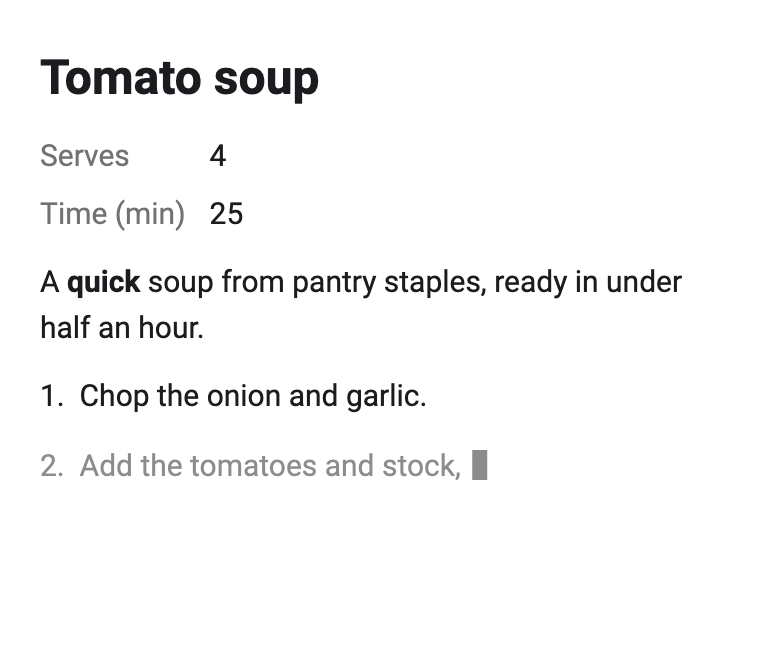

# llm_structured_ui

Flutter widgets that show an AI model's structured (JSON) output while it
is still being written, instead of waiting for the whole object.



A model asked for JSON sends it a few characters at a time. This package
reads the document as it grows (with
[partial_json](https://pub.dev/packages/partial_json)) and gives you:

- `StructuredStreamController`: takes the pieces and tells its listeners.
- `StructuredBuilder`: rebuilds after each piece and hands you a
  `StructuredValue`, which is safe to read while fields are missing.
- Ready widgets for the usual shapes: `StructuredText`, `StructuredList`,
  `StructuredFields`, `StructuredCard` and `StructuredAuto`.

The widgets use `package:flutter/widgets.dart` only, so they work in
Material and Cupertino apps. There is no native code.

## Example

A recipe that fills in as the model writes it:

```dart
StructuredBuilder.stream(
  recipeJsonStream, // Stream<String>: the model's text, piece by piece
  builder: (context, recipe) => Column(
    crossAxisAlignment: CrossAxisAlignment.start,
    children: [
      StructuredText(recipe['title']),
      StructuredFields(
        recipe,
        order: const ['servings', 'minutes'],
        labels: const {'servings': 'Serves', 'minutes': 'Time (min)'},
        hide: const {'title', 'summary', 'steps'},
      ),
      StructuredText(recipe['summary'], markdown: true),
      StructuredList(
        recipe['steps'],
        itemBuilder: (context, step, index) =>
            Text('${index + 1}. ${step['text'].asString ?? ''}'),
      ),
    ],
  ),
  errorBuilder: (context, error, recipe) => Text('Could not read: $error'),
)
```

For this JSON:

```json
{"title": "Pancakes", "servings": 4, "minutes": 20,
 "summary": "Thin and **quick**.",
 "steps": [{"text": "Mix"}, {"text": "Fry"}]}
```

## Reading the value: `StructuredValue`

The builder gets a `StructuredValue` for the document so far. Reading it
never throws:

```dart
data['title'].asString ?? ''          // null until the title has started
data['steps'][2]['text'].asString     // null: no third step yet
data['servings'].asNum                // null if it is missing or not a number
data['steps'].asList                  // the steps so far; [] if not a list
```

| | |
| --- | --- |
| `value[key]`, `value[index]` | the value under a key or at an index; one that does not exist if there is none |
| `asString`, `asNum`, `asInt`, `asDouble`, `asBool` | the value as that type, or null |
| `asList`, `asMap`, `length` | the items or entries so far; empty for anything else |
| `exists` | whether the value has started to arrive (a JSON `null` exists) |
| `isPending` | still being written: more of it can arrive |
| `isDone` | finished; it will not change |
| `isAwaited` | missing, but the map or list it belongs to is still open |
| `isMap`, `isList`, `isScalar`, `isNull`, `raw`, `path` | what it is and where |

After an error nothing is pending any more, and a value that was cut off
is neither pending nor done.

A value reads the document as it was when the value was made. Use it in
the build it was handed to; do not keep it in a field.

For JSON you already have whole, `StructuredValue(jsonDecode(text))` works
with every widget here, with everything done.

## The controller

```dart
final controller = StructuredStreamController();

controller.add(chunk);   // for each piece
controller.close();      // at the end

controller.value;        // the map/list so far
controller.data;         // the same as a StructuredValue
controller.isComplete;   // the JSON document is whole
controller.pendingPath;  // e.g. ['steps', 2, 'text']
controller.error;        // a FormatException for wrong or cut-off JSON
controller.reset();      // start a new document
```

It is a `ChangeNotifier`. `addStream(stream)` reads a `Stream<String>`: it
adds each event, closes at the end, and puts a stream error in `error`.
Its future completes when reading stops; `reset()` stops reading too.

`StructuredStreamController(repair: true)` also reads the common mistakes
in model JSON: single quotes, keys without quotes, comments, and Python's
`True`, `False` and `None`.

Text around the document is skipped, so a reply wrapped in a
```` ```json ```` fence or starting with "Here it is:" still reads.

## The widgets

### StructuredBuilder

```dart
StructuredBuilder(controller: controller, builder: (context, data) => ...)
StructuredBuilder.stream(stream, builder: (context, data) => ...)
```

Rebuilds after every piece. With an `errorBuilder`, that is built once the
controller has an error; it also gets the data read before the error.
Without one, `builder` keeps showing the last good value.

### StructuredText

```dart
StructuredText(data['title'])
StructuredText(data['summary'], markdown: true)
```

A string field. A blinking cursor follows the text while the field is
pending. With `markdown: true` the text is drawn by `StreamingMarkdown`
from [llm_markdown](https://pub.dev/packages/llm_markdown). Numbers and
bools are shown as text.

### StructuredList

```dart
StructuredList(
  data['steps'],
  itemBuilder: (context, step, index) => StructuredText(step['text']),
  showPendingItem: true,
)
```

Items appear as they arrive. The item still being written is drawn faded
(`StructuredStyle.pendingOpacity`); with `showPendingItem: false` it shows
only once it is finished. The items are in a `Column` that does not
scroll; for a very long list build a `ListView` from `value.asList`.

### StructuredFields

```dart
StructuredFields(
  data,
  labels: const {'servings': 'Serves'},
  order: const ['servings', 'minutes'],
  hide: const {'id'},
)
```

A table of labels and values for a flat object. Keys in `order` come
first and have a row with a placeholder line before they arrive; other
keys follow as they arrive. A key in `order` that never comes loses its
row when the object is finished. `valueBuilder` replaces the value widget
of a row.

### StructuredCard

```dart
StructuredCard(data, title: 'name', subtitle: 'cuisine', body: 'summary')
```

A card for an object. Each of title, subtitle, body and footer is a key
name (`title: 'name'`) or a builder (`titleBuilder: (context, value) =>
...`). Without a body, the keys that no other part uses are shown as
fields. `bodyMarkdown: true` draws the body as Markdown.

### StructuredAuto

```dart
StructuredAuto(data)
```

Draws any JSON value without configuration: strings as text, numbers and
bools as chips, flat objects as fields, lists of objects as cards, and
nested objects moved in under their key. For quick starts and for looking
at what a model sends.

### StructuredCursor and StructuredPlaceholder

The cursor and the placeholder line the widgets above use, for your own
layouts. Show them only while a value is pending or awaited:

```dart
if (data['price'].isAwaited) const StructuredPlaceholder(width: 60)
```

## Style

All widgets take their look from one `StructuredStyle`. By default it is
made from the `DefaultTextStyle` around them, so text, labels,
placeholders, chips and card borders follow your app's text color in
light and dark mode. To change it for a subtree:

```dart
StructuredTheme(
  style: StructuredStyle.of(context).copyWith(
    cursorColor: const Color(0xFF0066CC),
    cardRadius: 4,
    pendingOpacity: 0.3,
  ),
  child: ...,
)
```

Each widget also takes a `style`.

## Connecting a model stream

Any `Stream<String>` of the reply text works. Ask the model for JSON
(structured output, JSON mode, or a tool call) and pass the text deltas
on:

```dart
// Gemini (google_generative_ai / firebase_ai)
final stream = model
    .generateContentStream(prompt)
    .map((response) => response.text ?? '');

// OpenAI-style chat completions
final stream = completions.map((c) => c.choices.first.delta.content ?? '');

StructuredBuilder.stream(stream, builder: ...)
```

Create the stream once (in `initState`, or keep a controller), not in
`build`: a new stream starts a new document.

To keep the document after the widget is gone, or to show it in several
places, hold a `StructuredStreamController` yourself, call
`controller.addStream(stream)`, and use `StructuredBuilder(controller:)`.

For the arguments of a streamed tool call, pass the argument deltas
(OpenAI's `function.arguments`, Anthropic's `input_json_delta`) to
`controller.add`.

## Accessibility

- The cursor and placeholder lines are left out of the semantics tree.
- A row of `StructuredFields` is read as its label and value together.
- `StructuredList` and `StructuredCard` take a `semanticLabel`; a card's
  title is marked as a header.
- Nothing is announced when the object is finished. If your app should
  say so, listen to the controller and use `SemanticsService`.
- The cursor and placeholders do not animate when the platform asks for
  animations to be off (`MediaQuery.disableAnimations`), and nothing
  animates once the document is done.

## Limits

- One JSON document per controller. For several documents in one stream
  (JSON Lines), use `PartialJsonDocumentsDecoder` from `partial_json` and
  one controller per document.
- The widgets rebuild on every piece. That is fine for replies of a few
  kilobytes; for long lists use your own `ListView.builder` over
  `value.asList`.
- A `StructuredValue` is a view of the live document, not a copy. Take
  `controller.value` through `jsonDecode(jsonEncode(...))` if you need a
  copy that does not change.
- The package does not check the JSON against a schema. A field of the
  wrong type reads as null and shows as empty.
- `StructuredAuto` is for a quick look; it does not format dates, money
  or images.
- A stream that ends before the document is whole sets `error`, also when
  the stream was empty.

## License

MIT
